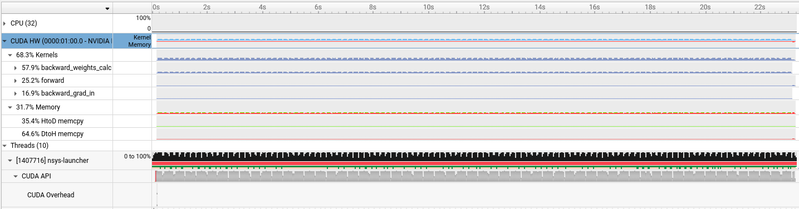

# Relatório de Desenvolvimento

## Problema 2

O código da V1 é paralelizado no Backward mas serial no Forward. Isso limita os benefícios da memória global da GPU, obrigando o código a transferir informações entre CPU e GPU com mais frequência.

### Evidência
```cpp
vector<float> Forward(vector<float> input) {
       last_input = input;
       last_z.resize(out_features);
       vector<float> out(out_features);
       // Cada neurônio soma o viés aos produtos entre entradas e pesos.
       for (int i = 0; i < out_features; ++i) {
       float sum = bias[i];
       for (int j = 0; j < in_features; ++j) {
              sum += input[j] * weights[i*in_features + j];
       }
       last_z[i] = sum;
       // As camadas ocultas usam ReLU. A última devolve escores lineares.
       out[i] = final ? sum : max(0.0f, sum);
       }
       return out;
}

vector<float> Backward(vector<float> grad_out, float learning_rate) {
       // Delta é o gradiente da perda em relação à soma antes da ativação.
       // Na ReLU, o gradiente passa apenas quando essa soma é positiva.

       vector<float> delta(out_features);
       for (int i = 0; i < out_features; ++i) {
       delta[i] = final ? grad_out[i]
                            : grad_out[i] * (last_z[i] > 0.0f ? 1.0f : 0.0f);
       }

       cudaMemcpy(d_delta, delta.data(), static_cast<size_t>(out_features) * sizeof(float), cudaMemcpyHostToDevice);
       cudaMemcpy(d_input, last_input.data(), static_cast<size_t>(in_features) * sizeof(float), cudaMemcpyHostToDevice);
       cudaMemcpy(d_bias, bias.data(), static_cast<size_t>(out_features) * sizeof(float), cudaMemcpyHostToDevice);


       constexpr int threads_per_block = 128;
       const int grad_blocks =
       (in_features + threads_per_block - 1) / threads_per_block;
       const int update_blocks =
       (out_features + threads_per_block - 1) / threads_per_block;

       backward_grad_in<<<grad_blocks, threads_per_block>>>(
       d_delta, d_wghts, d_grad_in, in_features, out_features);
       // const float* delta,
       // const float* weights,
       // float* grad_in,
       // int in_features,
       // int out_features

       backward_weights_calc<<<update_blocks, threads_per_block>>>(
       d_delta, d_wghts, d_bias, d_input, learning_rate, in_features, out_features);
       // const float* delta,
       // float* weights,
       // float* bias,
       // const float* input,
       // float learning_rate,
       // int in_features,
       // int out_features

       cudaDeviceSynchronize();

       vector<float> grad_in(in_features);
       // Transferencia de dados GPU → CPU
       cudaMemcpy(grad_in.data(), d_grad_in, static_cast<size_t>(in_features) * sizeof(float), cudaMemcpyDeviceToHost);
       cudaMemcpy(weights.data(), d_wghts, static_cast<size_t>(in_features) * out_features * sizeof(float), cudaMemcpyDeviceToHost);
       cudaMemcpy(bias.data(), d_bias, static_cast<size_t>(out_features) * sizeof(float), cudaMemcpyDeviceToHost);
       
       return grad_in;
}
```

### Primeira Iteração
Foi alterado o `Baren::Forward` para que os loops sejam paralelizados e utilizem os dados carregados na memória global.
Os loops aninhados foram substituidos por um loop único com paralelização entre threads.

```raw
Tempo de treino 16.1344 s
```



**31% do tempo da GPU foi dedicado à transferência de dados**

## Resultado
Comparado à versão passada que teve 38% do tempo, houve uma redução de transferência de dados entre GPU e CPU. Isso possibilitou um ganho em tempo de execução de aproximadadamente -2s.

Parte do motivo do speedup do cálculo não ser tão significativo pode ser o eixo do vetor em que a paralelização foi feita.
Os somatórios percorrem o "eixo X" do vetor 2D `weights`, ou seja, um somatório para cada neurônio de saída. Como é criada uma thread para cada calcular o somatório para cada neurônio de saída e a quantidade deles é menor do que a quantidade de neurônios de entrada o speedup fica limitado.


Resumo das etapas
---

| Hardware de execução |              Commit              | Tempo de execução |
| :------------------: | :------------------------------: | :---------------: |
|  Franky (merry_cpu)  |          (Código Base)           |      14.55s       |
|  Franky (merry_gpu)  |               (V1)               |      19.07s       |
|  Franky (merry_gpu)  | Forward com paralelização em GPU |      16.13s       |